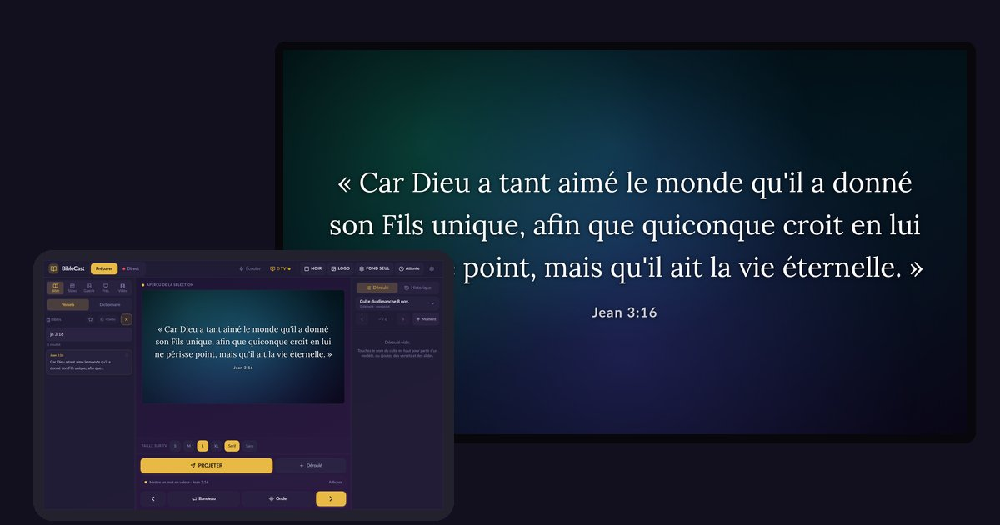

<p align="center"></p>

# BibleCast

**La Parole sur grand écran, sans gros budget.**

BibleCast transforme une tablette Android en régie de culte : versets, déroulé, annonces et louange s'affichent sur une ou deux TV Android, **sans Internet** et presque sans câble. Il est offert à toutes les églises qui n'ont ni les moyens ni la place pour du gros matériel.

👉 **Site, démo et téléchargement : https://idovic.github.io/biblecast/**

## Ce qu'il fait

- **La Bible en un instant** : Louis Segond 1910 et Darby, recherche par référence (« jn 3 16 ») ou par mots, comparaison des deux versions.
- **Dictionnaire biblique** : 622 articles (personnages, lieux, mots de la foi, coutumes, fêtes, les 66 livres), projetables écran par écran. L'église peut corriger ou ajouter des articles.
- **Déroulé du culte** : modèles prêts (culte du dimanche, réunion de prière, étude biblique), moments, mode Direct avec « Suivant ».
- **Slides, fonds animés, PDF et PowerPoint** (exporté en PDF), **images** et **vidéos** (copiées sur les TV avant le culte).
- **Onde de louange**, **bandeau d'annonces**, **écran d'attente** (verset du jour, horloge), **NOIR / LOGO / FOND SEUL**.
- **Écoute de la prédication** : la tablette entend « Jean trois seize » et propose le verset (reconnaissance vocale hors ligne).
- **Un écran différent par TV**, historique, TV qui démarre et retrouve la tablette toute seule.

Aucune donnée ne quitte l'église : pas de compte, pas de serveur, pas de publicité.

## Le matériel

| | |
|---|---|
| Tablette | Android 7 ou plus, même d'entrée de gamme |
| TV | 1 ou 2 TV Android (Android 5 ou plus), ou une TV ordinaire avec un boîtier Android TV |
| Réseau | Un Wi-Fi **sans Internet** : un dongle HDMI sans fil Miracast alimenté par le port USB de la TV (rien à recharger), ou un routeur Wi-Fi de poche |

## Contenu du dépôt

```
tablette/   l'app de régie (React + Vite + Capacitor 8), avec son serveur local HTTP/WebSocket
tv/         l'app Android TV (Java, WebView + lecteur vidéo Media3, découverte UDP)
docs/       le site (GitHub Pages) et la démo interactive
```

## Compiler

**Tablette** (Node 20+, Android Studio) :

```bash
cd tablette
npm install
npm run sync:android      # compile le site puis copie dans android/
# Android Studio : ouvrir tablette/android → Build → Build APK
```

La reconnaissance vocale utilise le modèle Vosk `vosk-model-small-fr-0.22` (41 Mo, non inclus) : décompressez-le dans `tablette/android/app/src/main/assets/vosk-model-fr/`. Sans lui, tout le reste fonctionne.

**TV** : ouvrir `tv/` dans Android Studio → Build → Build APK.

**Dictionnaire** : les articles sont dans `tablette/tools/dictionnaire/*.txt` ; voir le `LISEZMOI.md` du dossier pour régénérer `dictionnaire.json`.

## Contribuer

Traductions, nouvelles Bibles libres de droits, corrections du dictionnaire, nouvelles fonctions : ouvrez une *issue* ou une *pull request*. Gardez l'esprit du projet : **tout doit marcher sans Internet et rester léger** pour des TV modestes.

## Licence

[GPL-3.0](LICENSE) : vous pouvez utiliser, modifier et redistribuer BibleCast, à condition que les versions modifiées restent libres sous la même licence.

Textes bibliques : Louis Segond 1910 et Darby 1885 (domaine public).

## Contact

Frère Malachie (Sayon Idovic Loua) · sayonloua@gmail.com · WhatsApp +224 669 04 65 25

> « Vous avez reçu gratuitement, donnez gratuitement. » (Matthieu 10:8)
